# A tour of the runnr CLI

The terminal side of runnr, using the same demo runbook as the
[GUI tour](TOUR.md): moving an "orders" database to a new cluster. The CLI
and the GUI share one store, so a runbook saved, scheduled or run in one
shows up in the other. Every command is listed in the
[README](../README.md#cli); `runnr <command> --help` has the details.

- [Find your way around](#find-your-way-around)
- [Look before you run](#look-before-you-run)
- [Running](#running)
- [Changing course](#changing-course)
- [In tmux](#in-tmux)
- [Out of sequence](#out-of-sequence)
- [Unattended](#unattended)
- [Schedule](#schedule)
- [History](#history)
- [More](#more)

## Find your way around

Runbooks, the collections that group them, and the function libraries
they share.

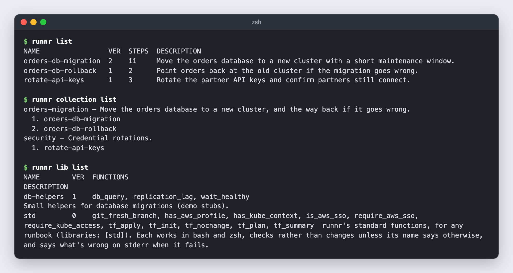

## Look before you run

`runnr inspect` lays a runbook out the way it will run: the sections and
their purpose, the maintenance window, what each step is (run, manual,
checks, ways…) and when it's planned relative to the window. Give it a step
number to see that step's code, or its ways (`*` marks the preferred one).
Add `-v key=value` to see the code with inputs filled in, or use `--all` to
show every step.

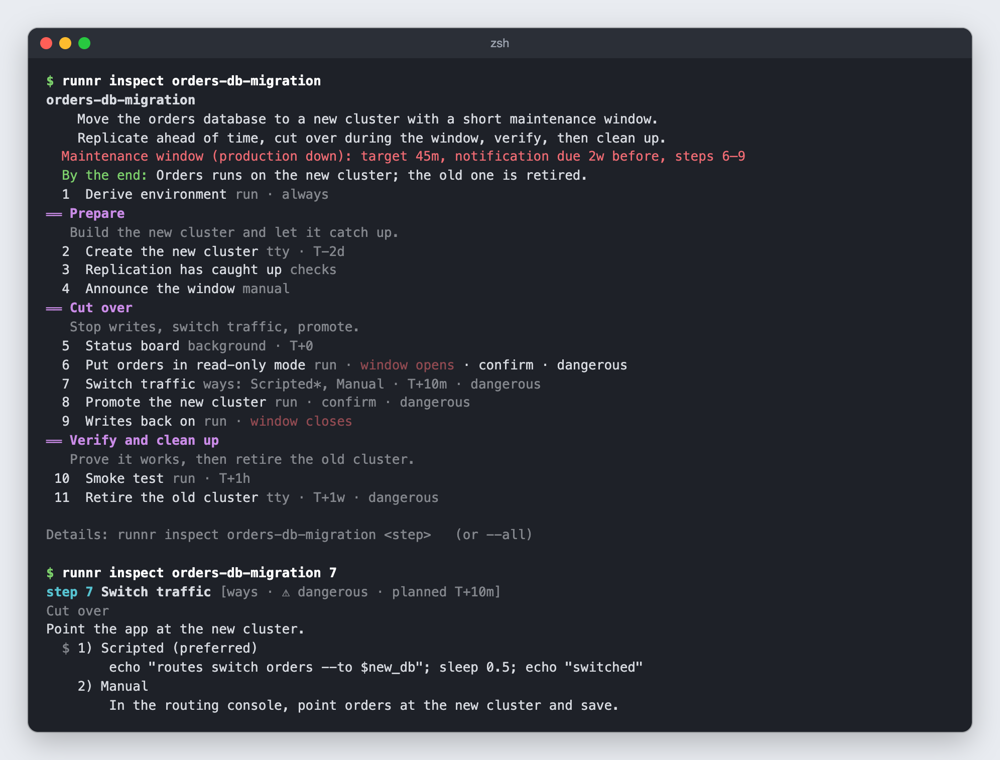

## Running

`runnr run` asks for any inputs you didn't pass with `-v`, then shows the
plan. Each step's result from last time is beside it. Before you start, you
can skip steps, set pauses before or after a step, view a step's code, or
step through every step.

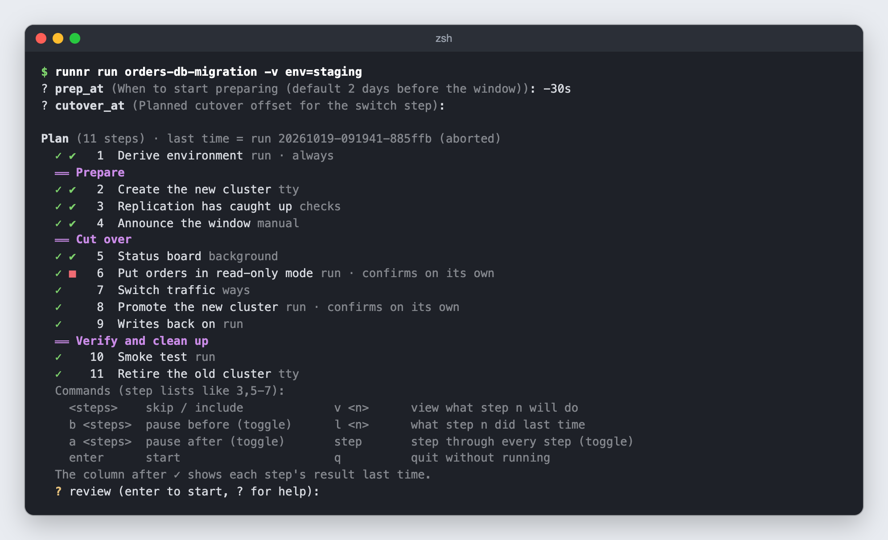

Steps run in order. Setup (`always`) steps publish values that later steps
use. A `tty` step connects you to its terminal, with the output recorded.
Checks show each check's result and the attempt.

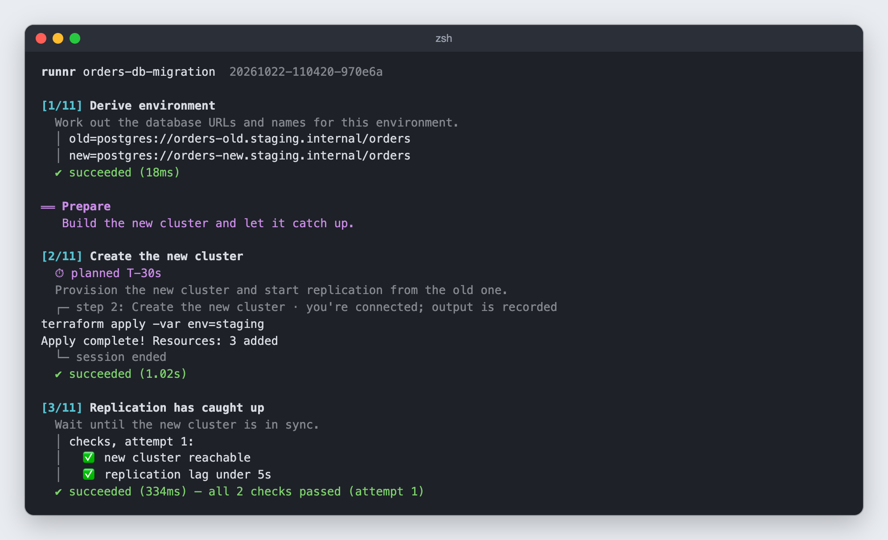

A manual step waits until you mark it done. A background step keeps running
alongside the others: press `w` at any prompt to watch it. The step that
opens the maintenance window says so and asks first (`confirm`). Planned
times show against the window (T+10m, and how far ahead or behind you are).
A step with ways runs its preferred way. At any prompt you can view the
step (`v`), see what it did last time (`l`), look at the environment (`e`),
add a note (`n`), open a shell (`!`), watch a background step (`w`), run a
command of your own in the background (`b`), go to another step (`g`),
change the run's inputs (`i`), or modify the step for this run (`m`).

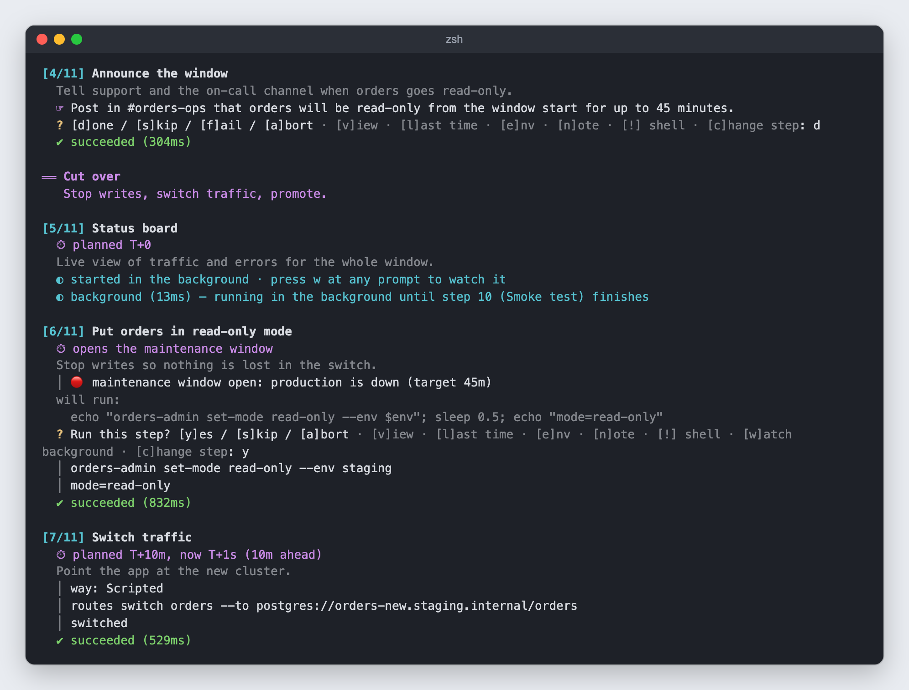

The window closes with how long it took against its target. The background
step stops after the step it was tied to, and the run ends with a summary.

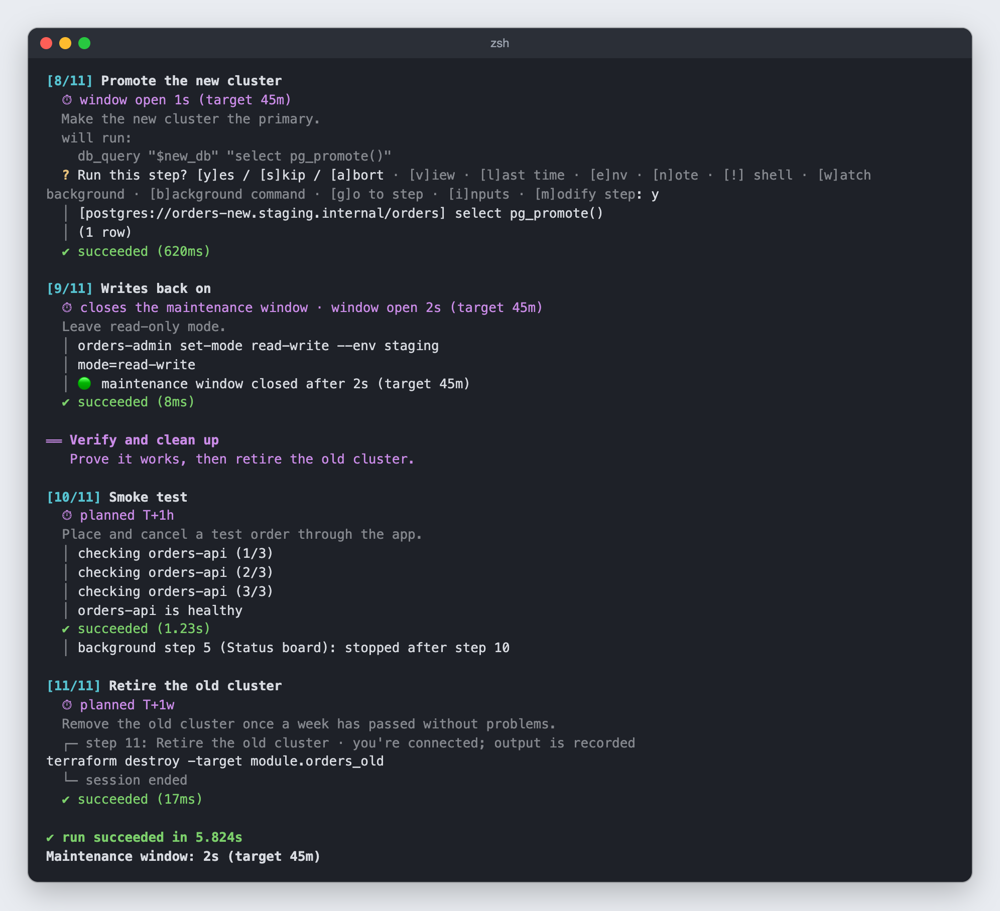

## Changing course

- **Stop a step**: Ctrl-C while a step's command runs stops that step, not
  the run. It fails as "stopped by you", and you choose what's next: retry,
  skip, force it, or go to a step. Ctrl-C again within 3 seconds aborts the
  run.
- **Go to a step** (`g`, at any step's prompt): back to a step that ran
  (Enter goes back one; it and the steps after it run again), this step
  again, or ahead (the steps between are skipped). The step you go to waits
  for you before it runs. Going back past a point of no return asks you to
  type `yes`.
- **Suspend** (`z`, at any step's prompt): stop the run to pick it up
  later, with an optional reason. It ends `suspended` (exit status 75) and
  `runnr resume <run-id>` carries it on. From another terminal,
  `runnr suspend <run-id>` asks the runnr running it: it stops once the
  step running now finishes (or at once if it's at a prompt); `--now`
  stops that step too.
- **Change the inputs** (`i`): new values are checked as at the start and
  take effect before the next command; a step waiting to run starts again
  with them. Each change is recorded, and runnr says which steps already
  ran with the old value.

## In tmux

`runnr run <runbook> --tmux` (and `resume --tmux`) starts the run in a tmux
session and attaches to it: the run on the left, `runnr watch` (the steps,
live) top right, and a shell with the run's variables bottom right.

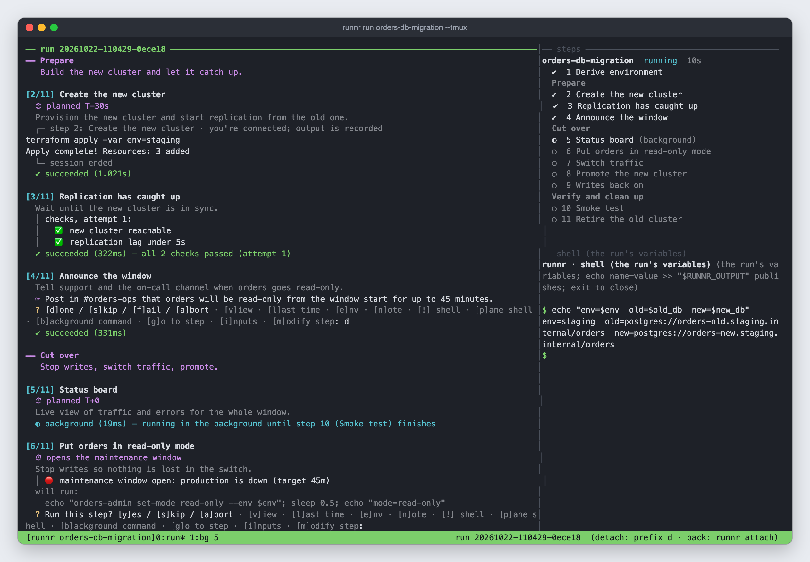

The shell is opened by the run, so it has every value, secrets included,
and keeps up as later steps publish more (zsh before each prompt and
command, bash before each prompt). What it publishes
(`echo name=value >> "$RUNNR_OUTPUT"`) reaches the run when its next step
starts.

`p` at a prompt opens another such shell, at the step you're on, in a pane
beside the run. The prompt stays where it is; `exit` closes the pane, and
the session is recorded with the step.

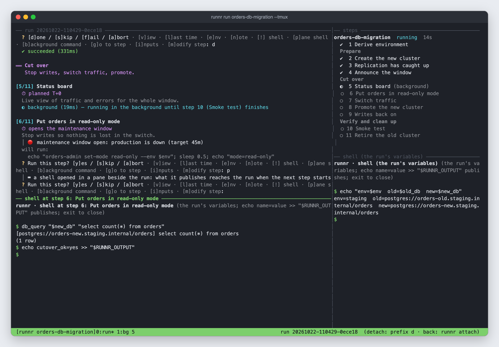

`b` runs a command of your own in the background with the run's
environment (here, watching replication lag). It gets a window (`job N`),
is recorded with the step, and ends with the run unless it ends first.

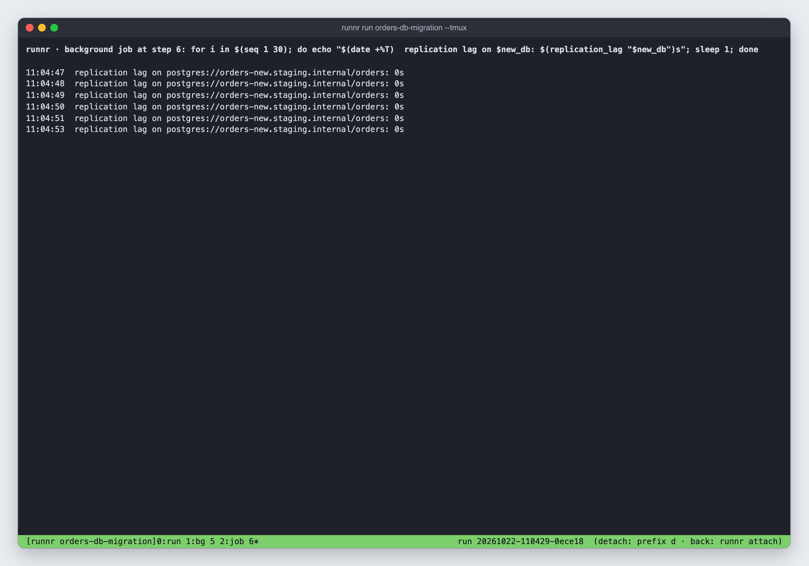

The run outlives your terminal. Close it, lose the connection, or detach
(prefix, then `d`), and `runnr attach` gets it back; with several such
runs, `runnr attach <run-id|runbook>`. Someone else logged in as the same
user can attach and watch too.

Each background step runs in a window of its own (`bg N`), outside runnr. If
the run fails or is aborted while one is still going, it's left running:
a Terraform apply isn't killed halfway. `runnr resume <run> --tmux` follows
it again, and a later step with `wait_for` waits for it to finish.

## Out of sequence

`--from` starts later. A `dangerous` step that runs when earlier steps
didn't lists what was skipped. To run it, you type its step number, not
just `y`. A run that's aborted or fails can be continued with
`runnr resume <run-id>`: the same run carries on, its log too, with each
resume and the earlier tries of steps done again recorded in it. If the
runbook has changed since, it carries on with the new version (steps
matched by name) and the log notes the version.

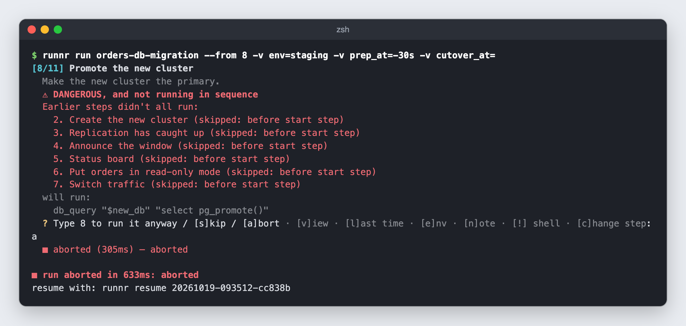

## Unattended

`-u` (`--unattended`) runs without prompts, for cron or CI. `-y`
(`--yes`) approves `confirm` steps. Manual and `tty` steps can't run
unattended unless the runbook says how (`unattended: pass` or `skip`).
Steps set to ask which way to go (`choose`) need `--use-preferred` to take
their preferred way.

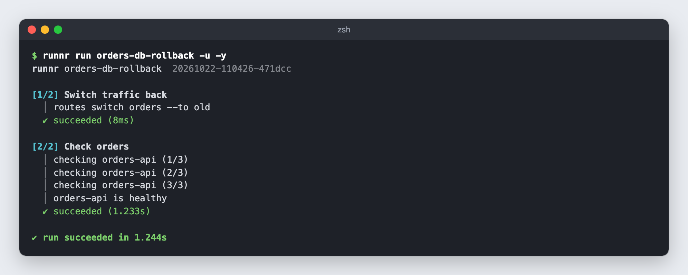

## Schedule

`runnr schedule add <runbook> --at "2026-10-31 22:00"` plans a run. The
agenda lays out each planned run by day: when the window must be
announced, the window itself, and when each section (or step, with
`--detail steps`) is due. Dates that fall on a weekend move to a weekday
(prep back to Friday, follow-up forward to Monday). Only the window stays
on the weekend. `--next` shows just the next thing to do for each run.

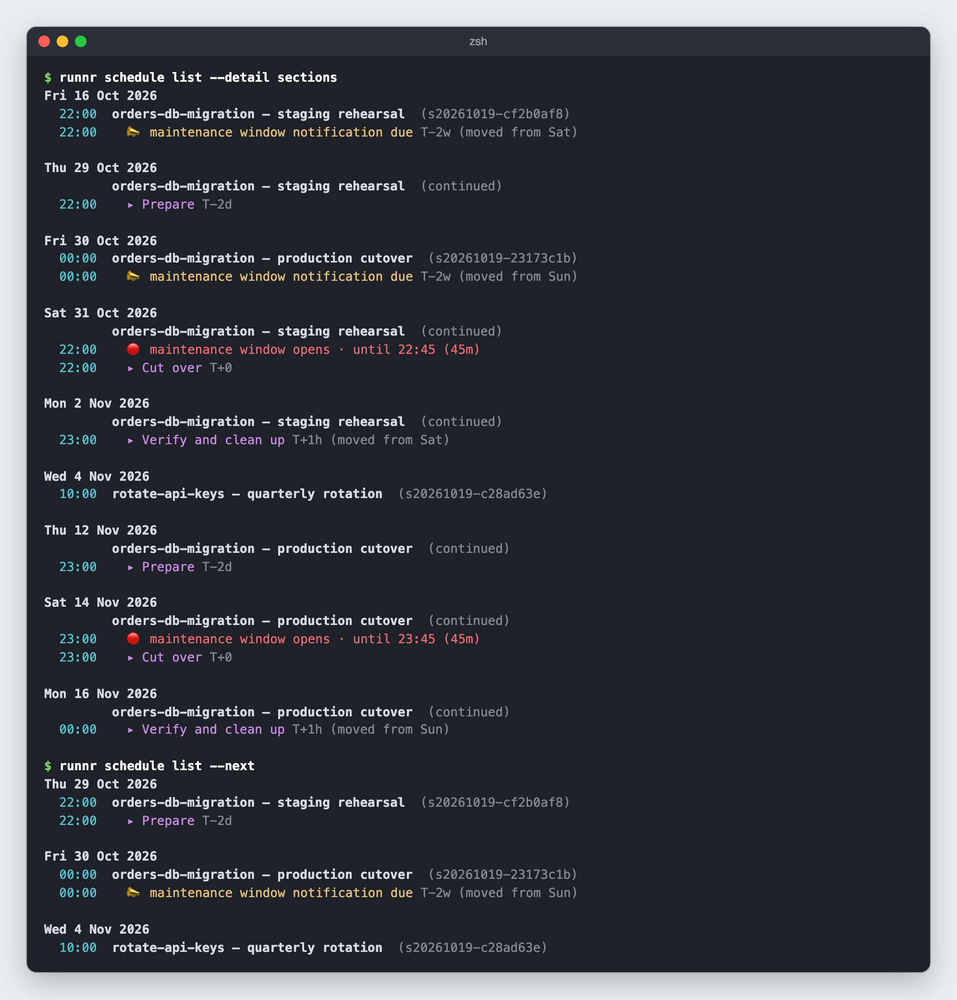

## History

Every run is kept with its inputs, the state its steps published, and what
each step ran and printed. Secrets are masked. `runnr rerun <run-id>` runs
again with the same inputs and compares each step with what it did last
time.

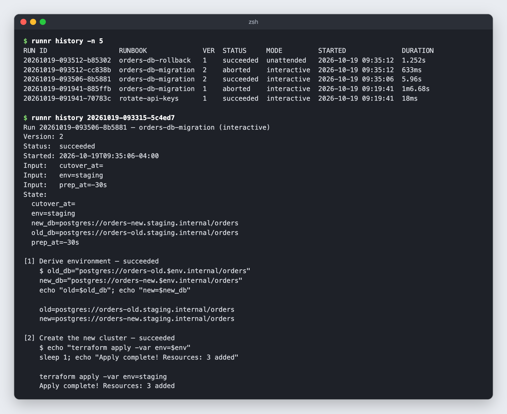

`runnr history <run-id> --timeline` draws the run in time, to the width of
the terminal: a row per step (its tries, earlier ones faded; shells and
jobs on a row under it), the run's row with the maintenance window, notes
(◆), input changes (✎) and resumes (↻), long idle stretches cut short
(╌), then its key moments. `--timeline=html` writes the same as a page
(`> run.html`), the one **◷ Timeline** shows in the GUI.

## More

- `runnr new` / `runnr edit` open a runbook in `$EDITOR`. It's saved only
  once it validates, and every save is a version (`runnr versions`,
  `runnr show --version N`).
- `runnr shell <runbook|run-id>` runs the setup steps, then opens a shell
  with their environment and the runbook's library functions. Given a run,
  it also has what the run's steps published (secret values aren't saved,
  so those it can't restore).
- `runnr import <folder|files>` adds runbooks, libraries, fake libraries,
  test suites and run records, filling in `@PROJECT_DIR@`-style
  placeholders (`--set`), checking references and finding missing
  libraries in the repository. A taken name needs `-f` (next version) or
  `--rename`; `-n` shows what it would do, and `--diff` also what saving
  over each taken name would change.
- `runnr export <runbook> -o file.yaml` writes the runbook with the
  libraries it uses beside it. `runnr history <run-id> --export <folder>`
  writes a run's logs, with the runs linked to it by resuming (`--as raw`,
  `json` or `both`, and/or `timeline` for a page per run, comma-separated;
  `--one-file`).
- `runnr delete` keeps every version: `runnr restore` lists what was
  deleted and brings it back. `runnr history --delete <run-id>` removes a
  run.
- `runnr explain <runbook> [step]` asks a model what a step does, what it
  relies on, and its risks. See "Ask Claude" in the README for setup.
- `runnr export <runbook>` writes the runbook as Markdown to follow by hand,
  with copy/paste-safe shell blocks. `-o page.html` writes a page to read
  instead: steps that expand, ways as tabs, and code as written or exactly
  as runnr runs it ([screenshot](TOUR.md#html-view)).
- `runnr serve --open` starts the GUI.
- `runnr doctor <runbook>` checks the programs its `requires` lists (and
  its libraries'), with versions and how to install what's missing.
- `runnr watch <run-id>` follows a run's steps as it goes.
