# A tour of runnr

Screenshots of the web GUI (`runnr serve`), using a demo runbook that moves an
"orders" database to a new cluster. Everything shown also works from the
[CLI](CLI.md).

- [Runbooks](#runbooks)
- [Running](#running)
- [The run console](#the-run-console)
- [HTML view](#html-view)
- [Editing](#editing)
- [Import and export](#import-and-export)
- [Schedule](#schedule)
- [Function libraries](#function-libraries)
- [Collections](#collections)
- [Manage](#manage)

## Runbooks

Pick inputs, choose how to run (interactive, step-through or unattended), and
see every step before it runs: grouped by section, with each section's purpose
and end state, planned times relative to the maintenance window (T-2d, T+0…),
and what each step did last time. Untick steps to skip them, or set ⏸ pauses.

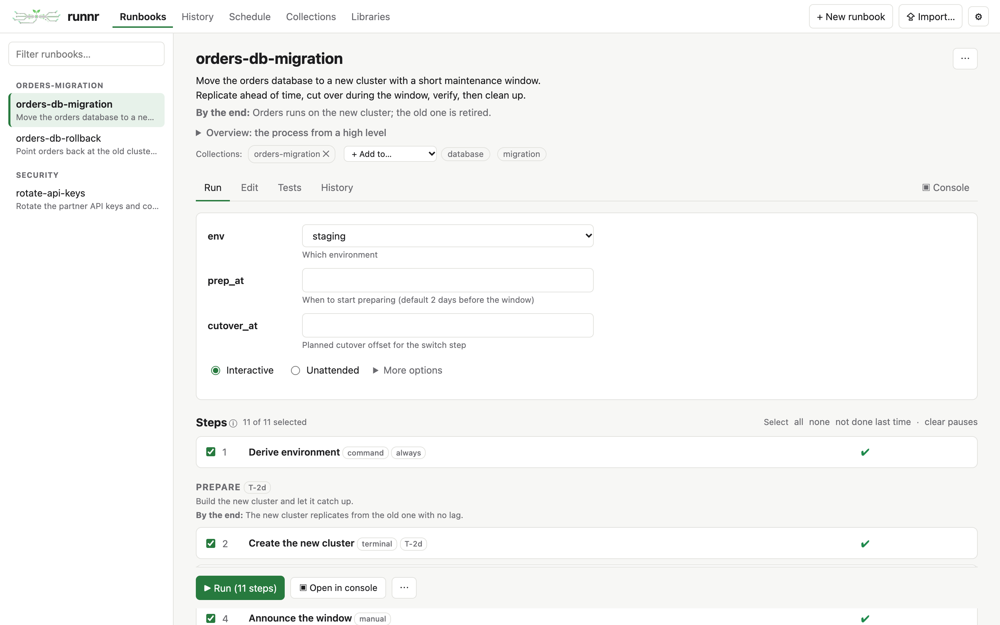

## Running

A live run. While the maintenance window is open, a banner counts the downtime
against its target.

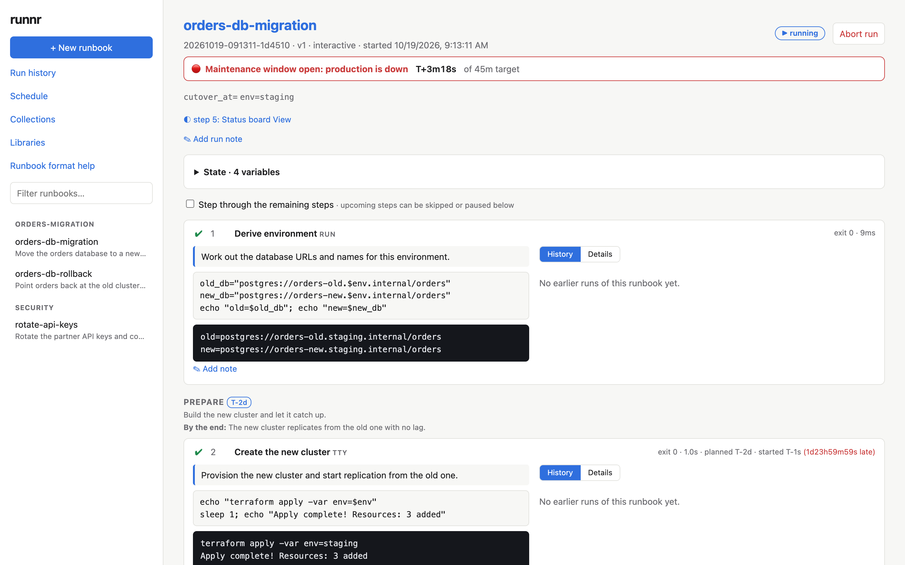

Steps stop for confirmations, manual instructions and failures. Each step shows
what it's doing, its command and its output; ⚠ dangerous steps ask for a typed
double check when they're run out of order. You can open a shell with the
run's variables, add notes, or ✎ edit a step mid-run and run it again. Under
every question, ↺ Back to step N and Go to step move the run (back runs the
steps from there again, ahead skips the ones between); ■ Stop step
interrupts a step whose command is running without ending the run, and
✎ Change inputs changes the inputs for the rest of the run.

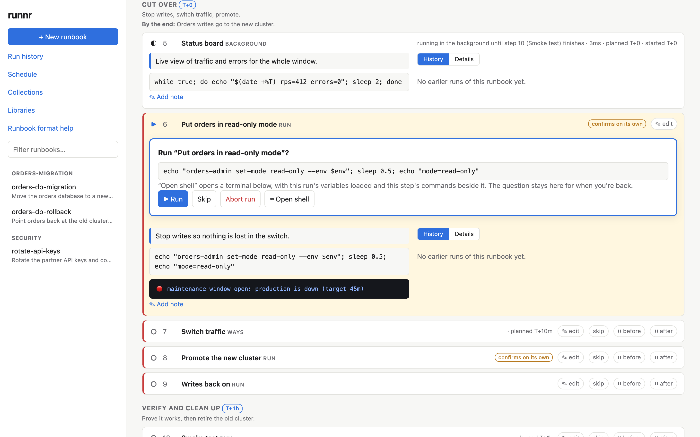

Background steps (here, a status board) keep running in their own terminal tab
while the run goes on; terminal steps run in the browser too.

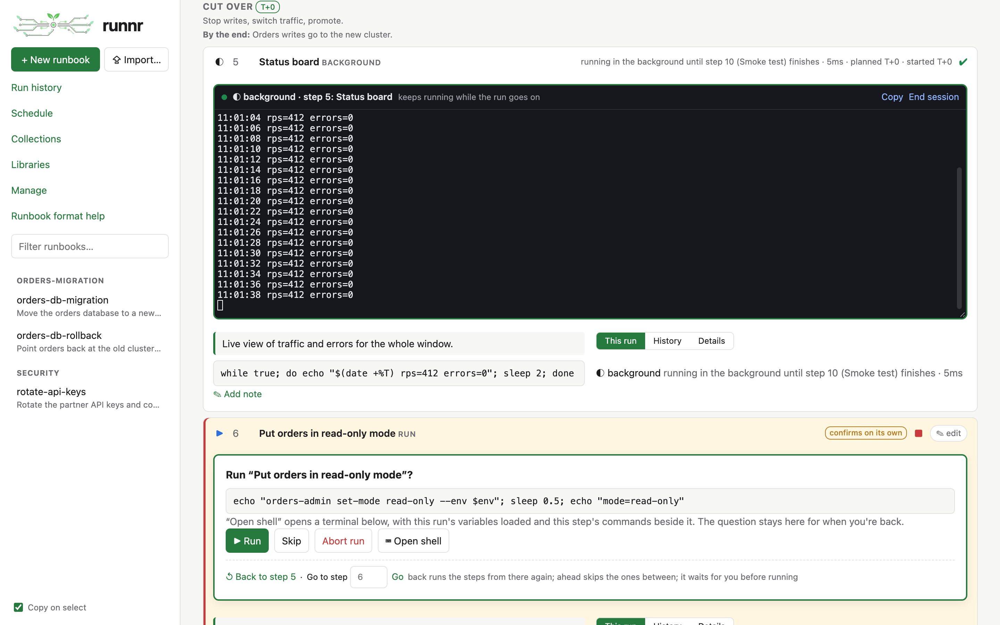

A finished run can ⇩ Export logs (with the runs linked to it by resuming:
raw logs to read, records to import elsewhere, one file or one per run) or
be deleted. Selecting text anywhere (a terminal, code, output) copies it;
Copy on select, in Settings (under ⚙), turns that off.

## The run console

▣ Console puts a run on one screen, in panes you arrange: drag a pane by
its bar onto another to split it or swap them, or split and close panes from
their bars. Panes are the step list, the step's definition, what it's doing
now (Step activity), a Step edit pane, the Terminal and Background targets,
the Run log, and Shells. A Shell opens before the run, alongside it (at the
step it's on, with the run's variables; what it publishes reaches the run
at the next step; recorded with the step, each line timed), or after it.
Unless pinned (📌), it's opened again at each step the run goes on to; ↻
starts it again at the current step. Here: the run waiting to put orders in read-only mode, a shell with
its variables, and the status board in the background.

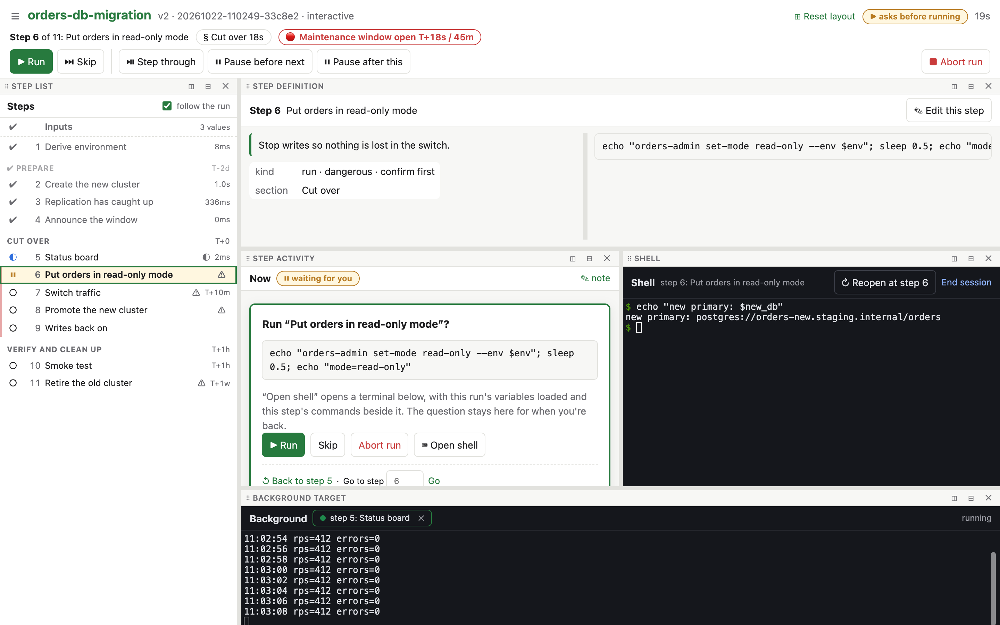

## Timeline

**◷ Timeline** on a run's page (or in its console; `runnr history <id>
--timeline` in a terminal) lays the run out in time: each step's tries,
the shells and jobs beside them, the maintenance window, notes, input
changes and resumes, then the key moments. Here a cutover failed one
afternoon and was resumed the next morning: the night between is cut
short, and the window gets a closer look of its own.

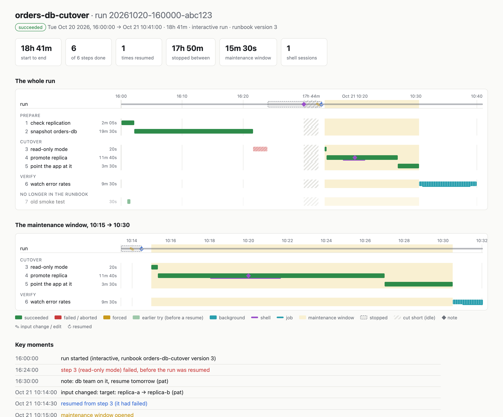

## HTML view

**View as HTML** (under ⋯ on the run page, or `runnr export <runbook> -o page.html`)
makes one self-contained page to read or share: the overview and the
sections at a glance, then sections and steps that expand and collapse,
with ways as tabs. Each step's code is in one box with a Copy button, as
written or as runnr runs it: a script to paste into one shell, with the
setup (inputs, functions, setup steps) once at the top or in each step.

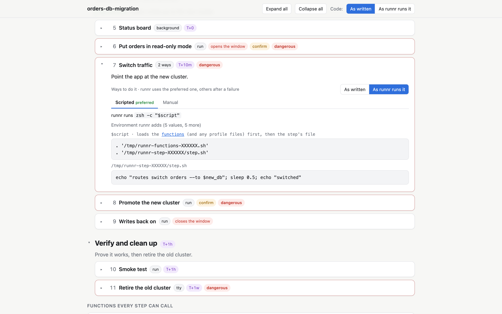

## Editing

The structured editor (YAML is a click away). Sections are headings in the
step list; drag ⠿ to reorder steps and sections. A step with several ways to
do it (Scripted, Manual…) shows them as tabs. ▶ Run this tries a step with test
values; 💬 marks YAML comments on fields; ⓘ explains every field.

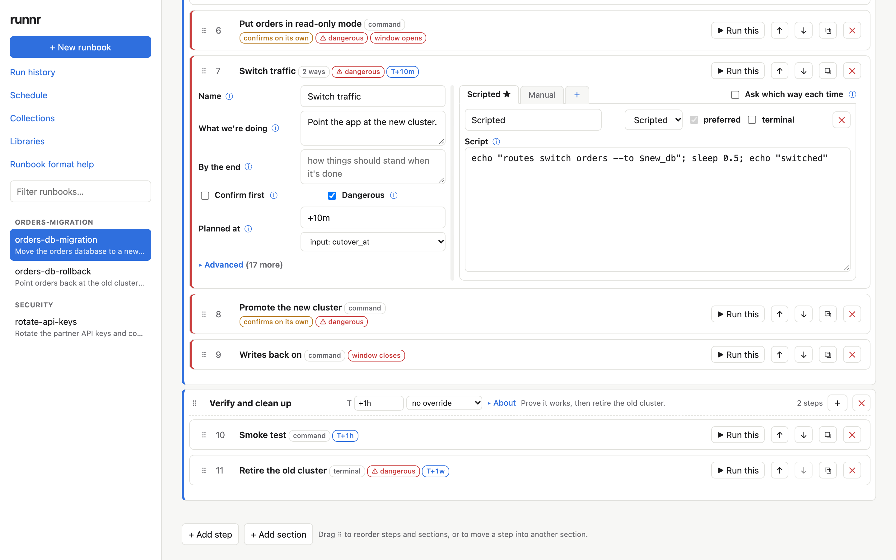

## Import and export

⇪ Import… in the top bar imports a project folder from the machine runnr
runs on: its runbooks, libraries, fake libraries, test suites and run
records. Placeholders such as `@PROJECT_DIR@` are kept as written (a run
fills them in with this machine's folders, set in Settings),
references are checked, and a
library missing from the folder is found elsewhere in the repository. A
name that's taken is never saved over without a choice; renaming a file
renames the references to it.

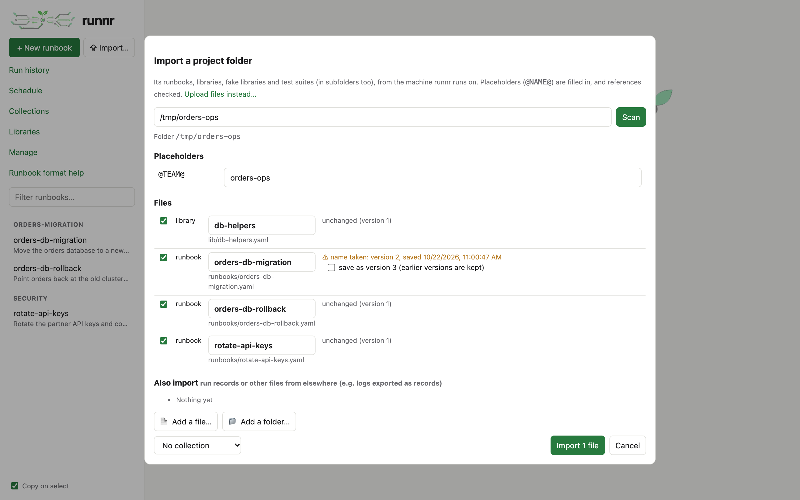

⇩ Export… on a runbook writes it, as written, with the libraries it uses
beside it, so the folder imports again. Inputs that are paths (`type: dir`
or `file`) get a Browse… button for this machine's folders and files.

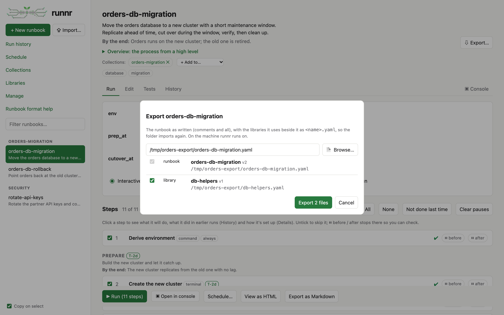

## Schedule

Plan runs ahead of time. For a runbook with a maintenance window, you schedule
when the window opens and runnr lays out the notification, sections and steps
around it, moving prep dates off weekends.

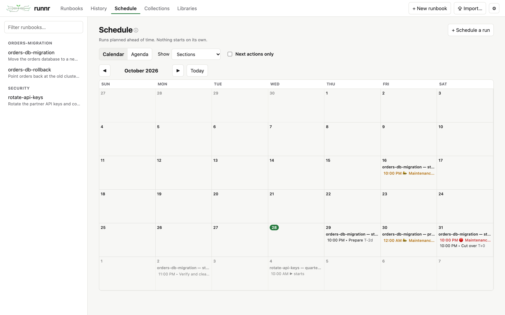

The same as an agenda, with each run's inputs; "Next actions only" shows just
what's coming up for each run.

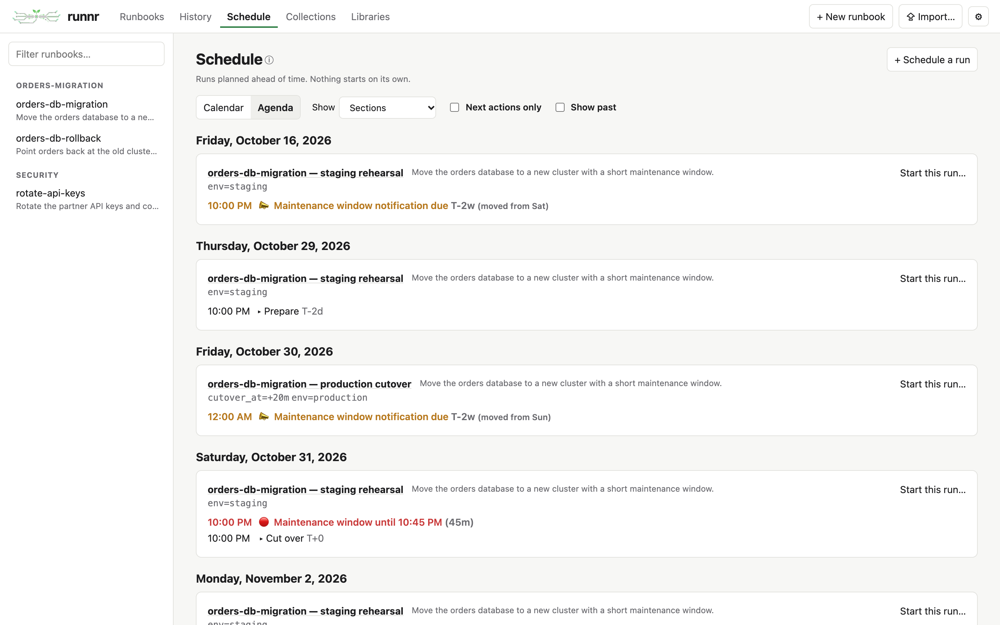

## Function libraries

Shell functions shared by runbooks: every step can call them, and shells opened
from runnr have them loaded. Steps that use one show ƒ, with the definition on
hover.

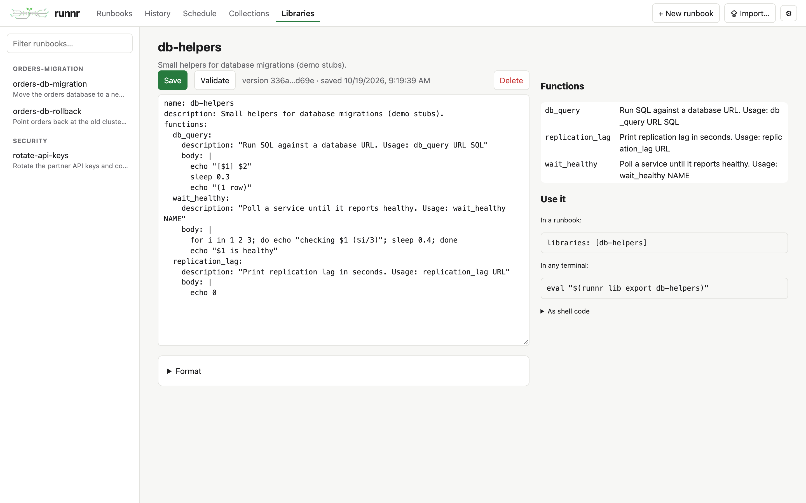

## Collections

Group runbooks that belong together. Drag a runbook between collections to move
it (Alt/⌥ to add it to another as well); names and descriptions edit in place.

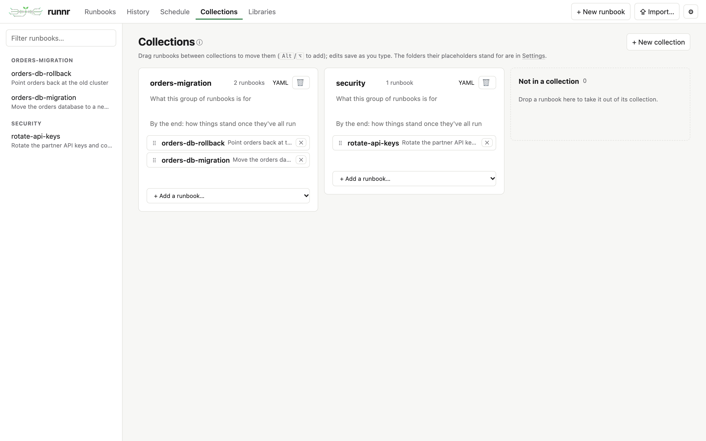

## Settings

Under ⚙. The folders placeholders stand for on this machine: `@REPOS_ROOT@`
for everything, and any placeholder for a collection or a single runbook.
Pick a collection to edit its folders and its runbooks' own; each runbook
shows where its value comes from (the runbook, its collection, or
everything) and whether a run can start. A value can
name another (`@REPOS_ROOT@/ops-runbooks`). Also this browser's own choices:
your name, whether runs open in the run page or the console, and Copy on
select.

**About runnr**, also under ⚙, shows the version, the commit and Go it was
built with, where the data lives and how long the server has been up, with
**Copy details** for a bug report.

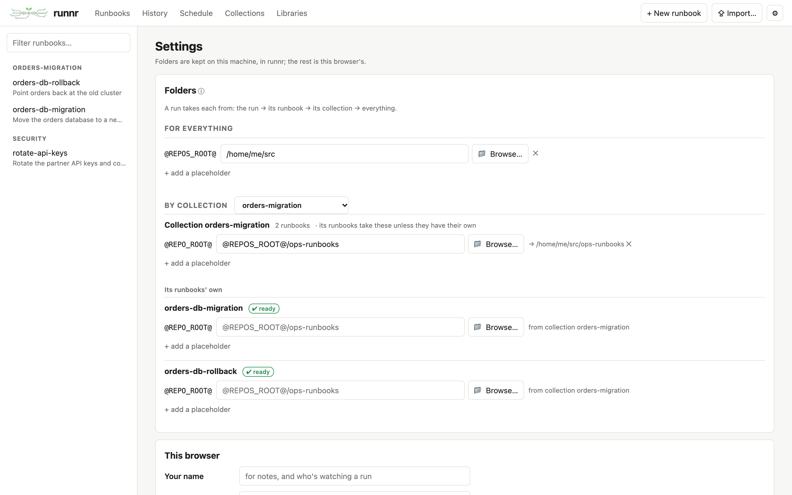

## Manage

Everything stored, by kind, with what uses each. Delete several at once (it
says first what depends on them); deleted things keep their versions and
can be restored here.

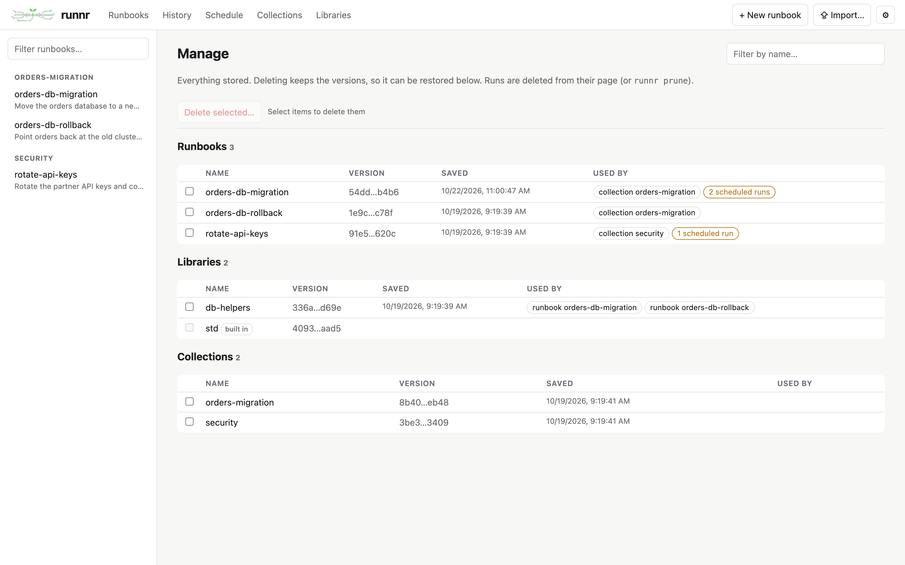
